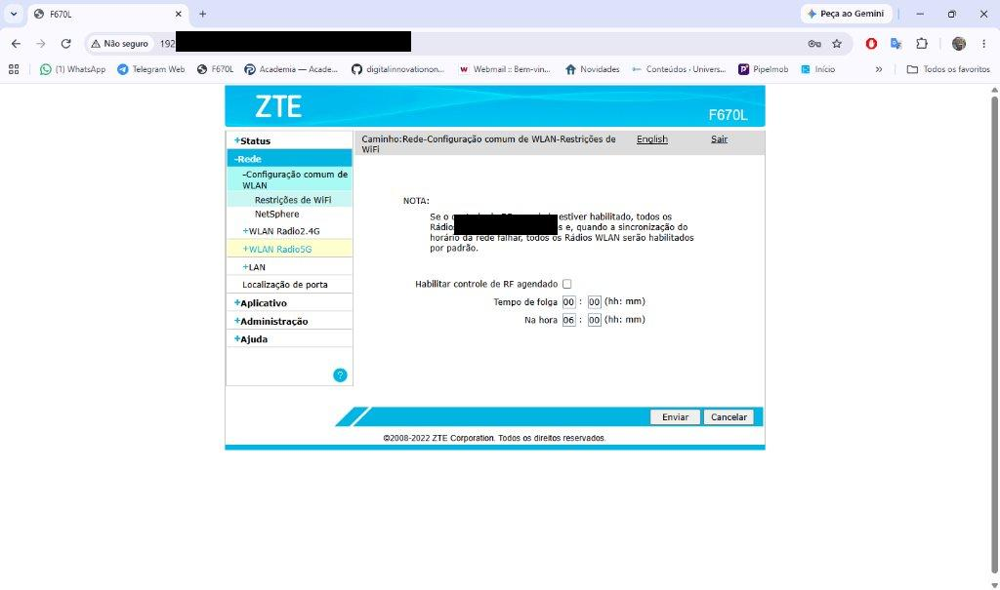
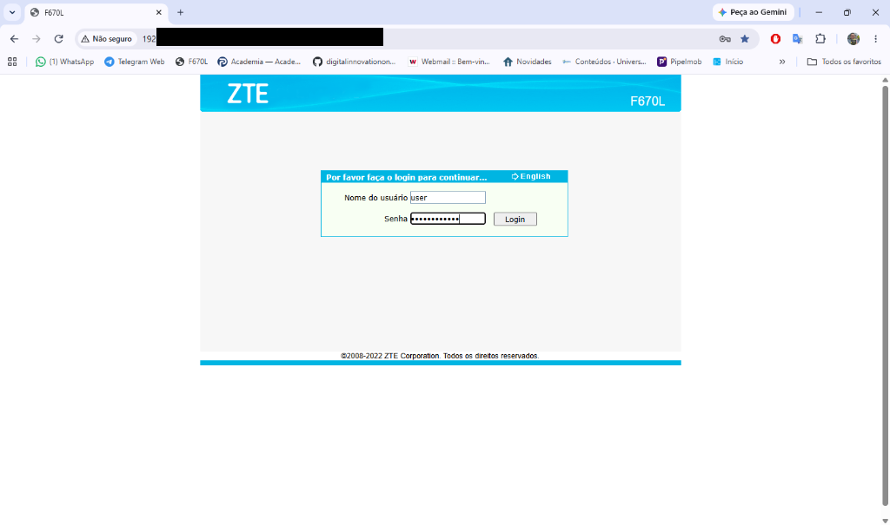
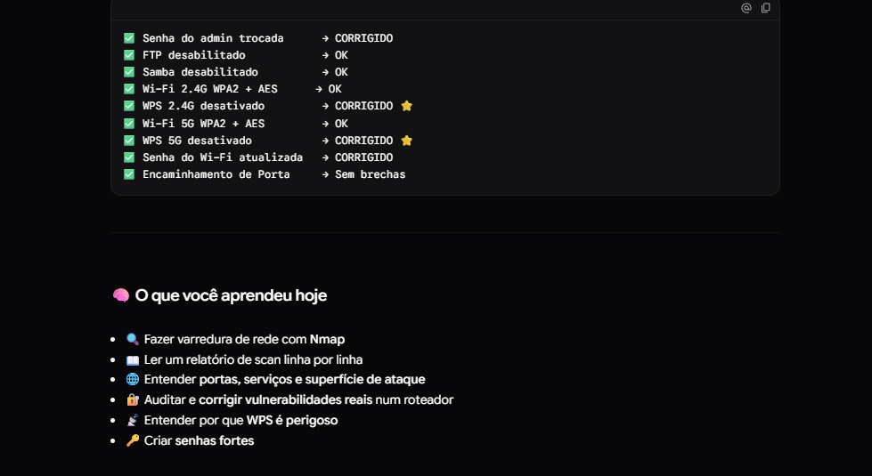

# 🔐 Auditoria de Segurança — Homelab

> Documentação da primeira auditoria de segurança de rede realizada no homelab pessoal.
> Data: 07/11/2026 | Ambiente: VirtualBox + Kali Linux | Alvo: Roteador ZTE F670L

---

## 🗺️ Topologia do Homelab

```
Internet
   │
[Roteador ZTE F670L] ← 10.0.0.1
   │
   ├── 10.0.0.2  → Dispositivo de rede (Host Engineering)
   ├── 10.0.0.3  → Repetidor Wi-Fi (Sichuan AI-Link)
   ├── 10.0.0.4  → Dispositivo desconhecido
   └── 10.0.0.6  → Kali Linux (máquina auditora)

VMs no VirtualBox (desligadas durante a varredura):
   ├── Ubuntu Desktop
   ├── Ubuntu Server (Wazuh SIEM)
   ├── Windows 10
   └── Parrot Linux (notebook)

Máquina principal: Windows 11
```

---

## 🛠️ Ferramentas Utilizadas

| Ferramenta | Versão | Para que usamos |
|---|---|---|
| **Nmap** | 7.99 | Varredura de rede e portas |
| **Kali Linux** | — | Sistema operacional do auditor |
| **Painel ZTE** | F670L V1.1.20P3N8B | Configuração do roteador |

---

## 📋 Etapa 1 — Descoberta de Dispositivos

### Comando utilizado
```bash
nmap -sn 192.168.1.0/24
```

### O que esse comando faz
- `-sn` = Scan sem portas (só descobre quem está online)
- `192.168.1.0/24` = Varre todos os 256 IPs da rede local

### Resultado obtido
```
10.0.0.1  → ZTE (Roteador)        MAC: XX:XX:XX:XX:XX:XX
10.0.0.2  → Host Engineering      MAC: XX:XX:XX:XX:XX:XX
10.0.0.3  → Sichuan AI-Link       MAC: XX:XX:XX:XX:XX:XX
10.0.0.4  → Desconhecido          MAC: XX:XX:XX:XX:XX:XX
10.0.0.6  → Kali Linux            (sem MAC — própria máquina)

5 hosts ativos de 256 IPs varridos em 5.05 segundos
```

> **Observação:** As VMs não apareceram porque estavam configuradas em modo **NAT** no VirtualBox. Para aparecerem na rede, precisam ser configuradas em modo **Bridge**.

---

## 📋 Etapa 2 — Varredura de Portas

### Comando utilizado
```bash
nmap -sV 10.0.0.1
```

### O que esse comando faz
- `-sV` = Detecta a versão dos serviços rodando em cada porta

### Resultado obtido
```
PORT    STATE    SERVICE   VERSION
23/tcp  filtered telnet
53/tcp  open     domain    ISC BIND 9.10.3-P4 (Debian Linux)
80/tcp  open     http
443/tcp open     ssl/https
```

### Como ler o resultado

| Coluna | Significado |
|---|---|
| `PORT` | Número da porta |
| `STATE` | `open` = aberta / `filtered` = bloqueada / `closed` = fechada |
| `SERVICE` | Serviço que roda nessa porta |
| `VERSION` | Versão do software |

---

## 🔓 Vulnerabilidade Principal — Credenciais Padrão em Equipamento Físico

### O que é essa vulnerabilidade?

Roteadores e modems fornecidos por operadoras chegam com **login e senha de fábrica** impressos numa etiqueta colada no próprio equipamento. Qualquer pessoa com acesso físico ao aparelho — um visitante, técnico, morador — consegue:

1. Ver as credenciais na etiqueta
2. Acessar o painel de administração em `http://10.0.0.1`
3. Alterar **qualquer configuração** da rede
4. Comprometer todos os dispositivos conectados

Essa vulnerabilidade é classificada como **Default Credentials** e está no topo da lista **OWASP IoT Top 10**.

---

### 🔴 Evidência 1 — Acesso ao painel com credenciais da etiqueta

As credenciais padrão foram encontradas na etiqueta adesiva no verso do roteador e utilizadas para acessar o painel administrativo:



> **O que a imagem mostra:** A tela de login do roteador ZTE F670L em `10.0.0.1`, acessada com o usuário `user` e a senha padrão impressa na etiqueta do equipamento. O acesso foi bem-sucedido, comprovando a vulnerabilidade.

> **Detalhe importante:** O navegador exibe `Não seguro` na barra de endereço — confirmando que o painel transmite os dados **sem criptografia (HTTP)**, expondo as credenciais na rede.

---

### 🔴 Evidência 2 — Acesso total às configurações da rede

Após o login com as credenciais padrão, foi possível acessar e modificar **todas as configurações de rede**, incluindo Wi-Fi, segurança e serviços:



> **O que a imagem mostra:** O painel de administração completamente acessível, exibindo as configurações de WLAN Rádio 5G. Com esse acesso, seria possível alterar senhas, abrir portas, habilitar serviços inseguros e comprometer toda a rede.

---

## 🔍 Análise Completa de Vulnerabilidades

### Vulnerabilidade 1 — Credenciais Padrão no Equipamento Físico 🔴 Crítica

| Item | Detalhe |
|---|---|
| **Tipo** | Default Credentials (OWASP IoT #1) |
| **Como explorar** | Ler a etiqueta no verso do roteador |
| **Acesso obtido** | Total — painel administrativo completo |
| **Impacto** | Comprometimento de toda a rede |
| **Status** | ✅ **CORRIGIDO** — senha trocada |

**Por que é grave:** Com acesso ao painel, um atacante pode:
- Redirecionar seu tráfego (DNS Spoofing)
- Instalar firmware malicioso
- Desativar a criptografia do Wi-Fi
- Monitorar todos os dispositivos da rede
- Abrir portas para acesso externo

---

### Vulnerabilidade 2 — WPS Ativado 🔴 Alta

| Item | Detalhe |
|---|---|
| **CVE** | CVE-2011-5053 |
| **Ferramenta de ataque** | Reaver (já incluso no Kali) |
| **Tempo para explorar** | 2 a 11 horas |
| **Problema** | PIN validado em duas metades — reduz de 100M para ~11.000 combinações |
| **Impacto** | Acesso à rede mesmo com senha WPA2 forte |
| **Status** | ✅ **CORRIGIDO** — WPS desativado em 2.4G e 5G |

```
PIN WPS: 1234 | 5670
         ↑       ↑
     validado  validado
     separado  separado  → apenas ~11.000 tentativas necessárias
```

---

### Vulnerabilidade 3 — DNS Desatualizado 🔴 Alta

| Item | Detalhe |
|---|---|
| **Porta** | 53/tcp |
| **Versão** | ISC BIND 9.10.3-P4 (2016) |
| **Risco** | DNS Spoofing — redirecionamento silencioso de sites |
| **Status** | ⚠️ Aguarda atualização de firmware pela operadora |

---

### Vulnerabilidade 4 — Telnet Presente 🟡 Médio

| Item | Detalhe |
|---|---|
| **Porta** | 23/tcp |
| **Estado** | `filtered` — bloqueado por firewall |
| **Risco** | Transmissão de senhas sem criptografia |
| **Status** | ✅ Filtrado — monitorar |

---

### Vulnerabilidade 5 — Painel Web HTTP 🟡 Médio

| Item | Detalhe |
|---|---|
| **Porta** | 80/tcp |
| **Problema** | Painel acessível sem criptografia |
| **Risco** | Interceptação de credenciais na rede local |
| **Status** | ⚠️ Limitação do firmware ZTE |

**Proteções ativas encontradas:**
- ✅ `X-Frame-Options: DENY`
- ✅ `X-XSS-Protection: 1; mode=block`
- ✅ `Content-Security-Policy`
- ✅ Cookie com `HttpOnly`
- ✅ Campo `Server:` vazio (identidade ocultada)

---

## 🛡️ Correções Aplicadas — Procedimentos

### Procedimento 1 — Troca da Senha de Administrador

**Caminho no painel:**
```
http://10.0.0.1 → Administração → Gestão de Usuários
```

**Critérios para senha forte:**
- Mínimo 12 caracteres
- Letras maiúsculas e minúsculas
- Números e símbolos (!@#$%)
- Sem informações pessoais

**Resultado:** Acesso ao painel protegido por credencial forte e única.

---

### Procedimento 2 — Desativação do WPS

**Caminho no painel:**
```
Rede → WLAN Rádio 2.4G → WPS → Desabilitar → Enviar
Rede → WLAN Rádio 5G  → WPS → Desabilitar → Enviar
```

**Resultado:** Vetor de ataque CVE-2011-5053 eliminado em ambas as bandas.

---

### Procedimento 3 — Verificação e Atualização da Senha Wi-Fi

**Caminho no painel:**
```
Rede → WLAN Rádio 2.4G → Segurança → Chave WPA
Rede → WLAN Rádio 5G  → Segurança → Chave WPA
```

**Configuração confirmada:**
- Autenticação: WPA2-PSK
- Criptografia: AES
- Senha: atualizada para senha forte

---

### Procedimento 4 — Verificação de Serviços Desnecessários

**Caminho no painel:**
```
Aplicativo → Aplicativo FTP    → Desabilitado ✅
Aplicativo → Serviço de Samba  → Desabilitado ✅
Aplicativo → Encaminhamento de Porta → Sem regras ativas ✅
```

---

## ✅ Evidência 3 — Checklist Final de Correções



> **O que a imagem mostra:** Relatório final da auditoria com todas as vulnerabilidades identificadas e suas respectivas correções aplicadas, confirmando que a rede foi endurecida (hardening) com sucesso.

---

## 📊 Resumo Executivo

| # | Vulnerabilidade | Severidade | Status |
|---|---|---|---|
| 1 | Credenciais padrão no equipamento | 🔴 Crítica | ✅ Corrigido |
| 2 | WPS ativado (2.4G e 5G) | 🔴 Alta | ✅ Corrigido |
| 3 | Senha Wi-Fi fraca | 🔴 Alta | ✅ Corrigido |
| 4 | DNS desatualizado (BIND 9.10.3) | 🔴 Alta | ⚠️ Pendente (operadora) |
| 5 | Painel HTTP sem criptografia | 🟡 Médio | ⚠️ Limitação do firmware |
| 6 | Telnet (porta 23) | 🟡 Médio | ✅ Filtrado |
| 7 | FTP ativo | 🟡 Médio | ✅ Já desabilitado |
| 8 | Samba ativo | 🟡 Médio | ✅ Já desabilitado |
| 9 | Port Forwarding indevido | 🟡 Médio | ✅ Sem regras |

**Resultado: 7 de 9 vulnerabilidades corrigidas. 2 dependem da operadora/firmware.**

---

## 📊 Configuração Final do Roteador

```
Modelo:          ZTE F670L
Firmware:        V1.1.20P3N8B
Hardware:        V1.1.01

Administração:
  Senha admin:   Trocada por senha forte ✅

Wi-Fi 2.4G:
  Segurança:     WPA2-PSK ✅
  Criptografia:  AES ✅
  WPS:           Desativado ✅
  Senha:         Atualizada ✅

Wi-Fi 5G:
  Segurança:     WPA2-PSK ✅
  Criptografia:  AES ✅
  WPS:           Desativado ✅
  Senha:         Atualizada ✅

Serviços:
  FTP:           Desabilitado ✅
  Samba:         Desabilitado ✅
  Telnet:        Filtrado ✅
  Port Forward:  Sem regras ✅
```

---

## 📚 Conceitos Aprendidos

### Fundamentos de Rede
- **IP** — endereço único de cada dispositivo na rede
- **Porta** — entrada específica de um serviço em um dispositivo
- **Superfície de ataque** — tudo que está exposto na rede
- **NAT vs Bridge** — modos de rede das VMs

### Conceitos de Segurança
- **Default Credentials** — vulnerabilidade #1 em dispositivos IoT (OWASP)
- **WPS (CVE-2011-5053)** — PIN quebrável mesmo com WPA2 forte
- **WPA2-PSK + AES** — padrão atual de segurança Wi-Fi
- **DNS Spoofing** — redirecionamento malicioso de domínios
- **Service Fingerprint (SF)** — impressão digital de serviços no Nmap
- **Hardening** — processo de redução da superfície de ataque

### Ferramentas
- **Nmap** — scanner de rede e portas
  - `nmap -sn <rede>` → descoberta de hosts
  - `nmap -sV <ip>` → varredura de portas com versões
- **ip a** — mostra interfaces e IPs no Linux

---

## 🚀 Próximos Passos

```
⬜ Configurar VMs em modo Bridge no VirtualBox
⬜ Varrer Ubuntu Desktop
⬜ Varrer Ubuntu Server (Wazuh)
⬜ Varrer Windows 10
⬜ Estudar fundamentos de protocolos TCP/IP
⬜ Aprender a ler logs do Linux
⬜ Aprender a ler logs do Windows
⬜ Explorar painel do Wazuh
⬜ Entender alertas e níveis de severidade do Wazuh
⬜ Solicitar atualização de firmware à operadora
```

---

## 📖 Referências

- [DIO — Formação de Cibersegurança](https://dio.me)
- [Nmap Official Documentation](https://nmap.org/docs.html)
- [CVE-2011-5053 — WPS Vulnerability](https://nvd.nist.gov/vuln/detail/CVE-2011-5053)
- [OWASP IoT Top 10](https://owasp.org/www-project-internet-of-things/)
- [Wazuh Documentation](https://documentation.wazuh.com)

---

*Documentação criada como parte do aprendizado em Cibersegurança — DIO Homelab*
